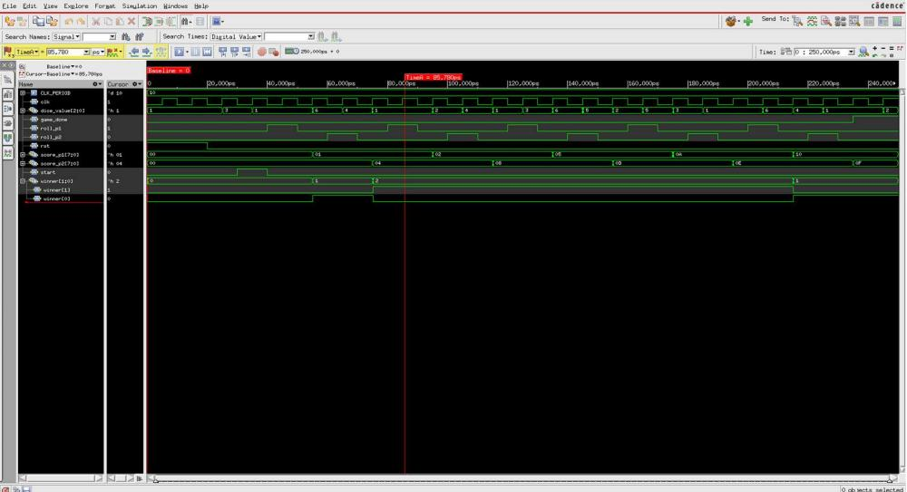
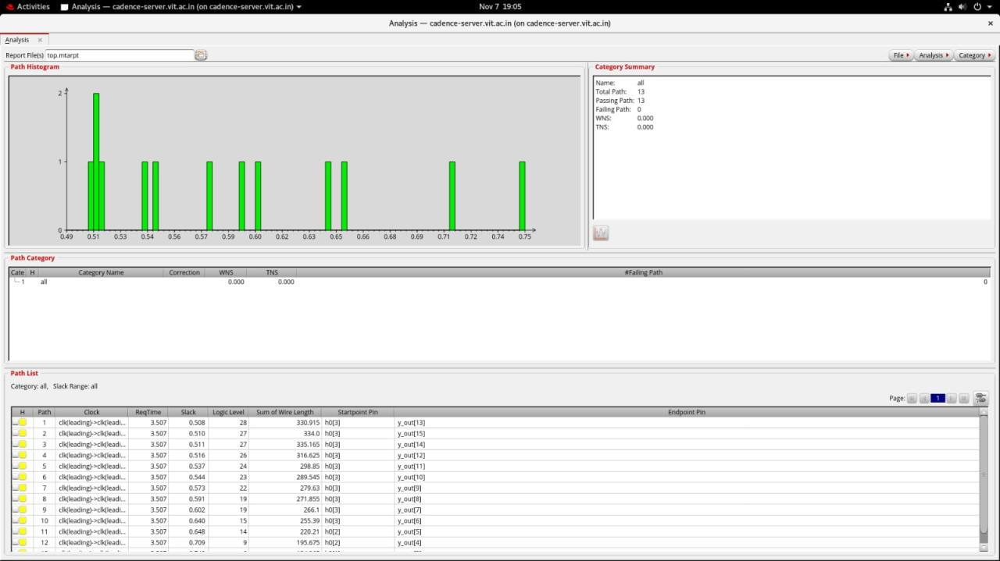
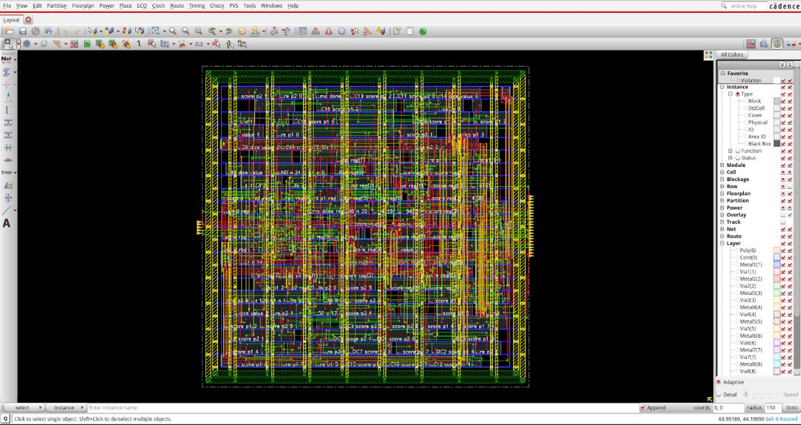
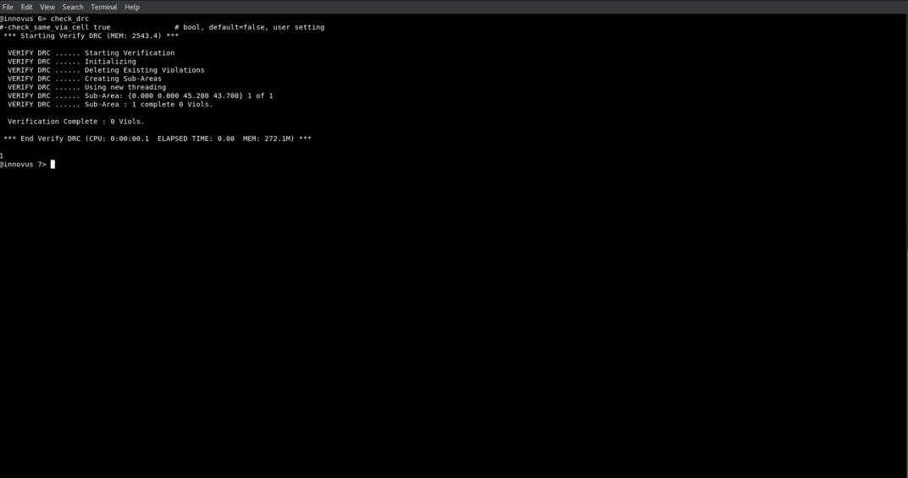
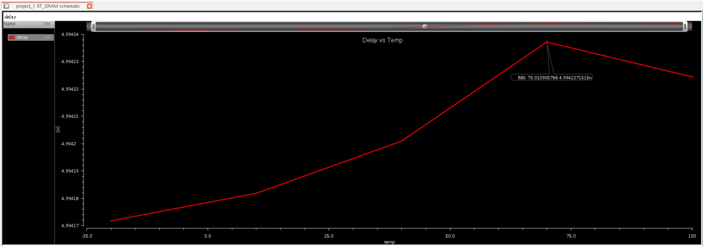

<h1 align="center">Hi, I'm Rajeswaran </h1>

  <b>Final-year ECE student @ VIT Vellore · Aspiring VLSI / Chip Design Engineer</b>

  
  

---

## About Me

I'm a final-year **Electronics and Communication Engineering** student at **VIT Vellore**, interested in the semiconductor industry, especially **VLSI design, digital electronics, and chip design**.

Through my academic projects I've worked with the **RTL-to-GDSII design flow** and industry-standard **EDA tools**. I'm looking to build on that with hands-on experience, and I'm open to opportunities where I can apply these skills and learn more about semiconductor design and development.

---

## Skills & Tools

HDL & Programming

Verilog, SystemVerilog, Embedded C, Python

Tcl, Perl, 8051 Assembly

EDA Tools

Cadence Virtuoso

Cadence Genus

Cadence Innovus

Cadence Tempus

Cadence Xcelium

QuestaSim, ModelSim

Intel Quartus Prime

VLSI & Digital Design

Digital Electronics and Boolean Algebra

CMOS and MOSFET Fundamentals

RTL Design and Functional Verification

RTL-to-GDSII Flow (academic project exposure)

Static Timing Analysis (Setup and Hold)

Low-Power Digital Design

SRAM Circuit Design Fundamentals

---

## Featured Projects

### 1️⃣ Two-Player Electronic Dice Game: RTL to GDSII

A two-player dice game written in **Verilog HDL** and taken through the full **RTL-to-GDSII flow**: functional simulation, synthesis, place and route, timing analysis, and DRC verification.

**How the game works**
- A digital dice built on an **LFSR (Linear Feedback Shift Register)** generates pseudo-random values from **1 to 6**.
- Two players roll alternately, **5 rolls each** by default.
- After all rolls, the total scores are compared and the higher score wins.
- `winner` is a 2-bit output: `2'b01` = Player 1 wins, `2'b10` = Player 2 wins, `2'b00` = Draw.
- `game_done` goes high once all rolls are complete. Everything is synchronised by clock and reset.

**Architecture** (modular design)

| Module | Role |
|---|---|
| **Dice Generator** | LFSR-based shift register producing dice values 1–6 |
| **Score Accumulator** | Holds both players' scores and adds the dice value to whoever's turn it is |
| **Controller** | Runs the game flow: counts rolls, switches turns, enables score updates, signals completion |
| **Roll Counter** | Tracks the total number of rolls and manages turn switching |
| **Winner Logic** | Compares the final scores and decides win or draw |
| **Top-Level Wrapper** | Connects all modules and handles the system's inputs and outputs |

#### Functional Simulation

  

The waveform from the Cadence simulator verifies the design end to end, with a clock period of 10 time units over a 250 ns run. After `rst` is released and `start` is pulsed, `roll_p1` and `roll_p2` alternate, so the players take turns. `dice_value[2:0]` stays within 1–6 on every roll, which confirms the LFSR output is correctly bounded. `score_p1` and `score_p2` accumulate after each roll, and in this run they finish at **16 (0x10)** and **15 (0x0F)**. `game_done` rises once the last roll completes, and the `winner` output settles to `2'b01`, so **Player 1 wins**. This matches the expected comparison of the two final scores.

#### Timing Analysis

  

The post-implementation timing report (`top.mtarpt`) shows a slack histogram and a path summary. All **13 timing paths pass, with 0 failing paths, WNS = 0.000 and TNS = 0.000**. The path list shows paths from the `h0[...]` registers to the `y_out[...]` outputs under the same clock with a required time of 3.507. The tightest path has about **0.508 slack** and runs through 28 logic levels (the longest in the list). Shorter paths have progressively more slack, up to about 0.75. In other words, the design meets timing with margin.

#### Physical Design: Place & Route

  

This is the final routed layout in **Cadence Innovus**. The standard cells, such as the score and dice-value registers (`score_p1_reg`, `score_p2_reg`, `dice_value_reg`, `game_done_reg`), are placed in rows inside the core. The power ring and power stripes on multiple metal layers surround and cross the core area, and the I/O pins sit along the left and right edges. The design is fully routed, and the DRC run below confirms the result is clean.

#### Design Rule Check (DRC)

  

Running `check_drc` in Innovus verifies the layout against the design rules. The log ends with **"Verification Complete: 0 Viols."** over the whole design area (about **45.2 × 43.7 µm**), so the layout is DRC-clean.

**Tech:** `Verilog HDL` · `LFSR` · `FSM / Controller design` · `Cadence simulation` · `Cadence Innovus` · `STA` · `DRC`

---

### 2️⃣ Low-Power 8T SRAM with Power Gating (90 nm CMOS)

A **low-power 8T SRAM cell** with a **power-gating (sleep transistor)** scheme to cut standby leakage, designed and simulated in **Cadence Virtuoso** using the **GPDK 90 nm** process at **VDD = 1 V**. I compared the cell with power gating ON and OFF.

*Team project with Tarun Rithvik B, Krithik B and Mohammad Oomar Farooq S.*

**Why 8T + power gating?**
- A 6T cell suffers from **read-disturb** and high leakage at scaled nodes. The 8T cell adds a **separate read path** (RWL/RBL), so the storage nodes are never disturbed during reads.
- A high-threshold **sleep transistor** (4800 nm / 100 nm) cuts the cell off from the rail during standby, which sharply reduces subthreshold and gate-oxide leakage while the latch keeps its data.

#### Schematic

  

The cross-coupled inverters form the storage latch. The write access transistors connect the storage nodes to `BL`/`BLB` under `WL`, and the two extra NMOS transistors form the isolated read path driven by `RWL`. The sleep transistor controlling the virtual rail is driven by the `SLEEP` signal.

#### 📈 Transient Analysis: Read/Write Functionality

| Power gating OFF | Power gating ON |
|:---:|:---:|
|  |  |

Both modes complete correct write and read cycles, with clean transitions on the outputs. With gating ON, the outputs are slightly attenuated and the cell still behaves correctly.

#### Delay vs Temperature (−40 °C to 125 °C)

  

Read delay rises gradually with temperature because of lower carrier mobility. The gated cell stays **fully functional across the whole range**, so the sleep transistor adds negligible resistance in active mode.

#### Average Power Comparison

| Power gating OFF | Power gating ON |
|:---:|:---:|
|  |  |

| Mode | Average Power (Peak) |
|---|---|
| Power gating OFF | **1.3421 µW** |
| Power gating ON | **64.1481 nW** |

That is roughly a **95% reduction** in average power with power gating enabled.

#### Stability: Butterfly Curve & Read SNM

  

The butterfly curve (two mirrored inverter VTCs) gives a **Read Static Noise Margin of 276.808 mV**, showing the cell holds its data robustly.

**Key results**

| Metric | Result |
|---|---|
| Technology | GPDK 90 nm, VDD = 1 V, L = 100 nm |
| Average power reduction (gating ON vs OFF) | ≈ **95%** (1.3421 µW → 64.1481 nW) |
| Read Static Noise Margin | **276.808 mV** |
| Temperature range verified | −40 °C to 125 °C |
| Functionality | Read, write and data retention verified in both modes |

**Tech:** `Cadence Virtuoso` · `GPDK 90 nm` · `CMOS` · `Power Gating` · `SNM Analysis` · `Transient / DC analysis`

---

<!--
============================================================
3️⃣ PROJECT 3: PLACEHOLDER. Fill this in, then delete the comment markers.
============================================================

### 3️⃣ Your Project Title

One or two lines on what it is and why it matters.

**Highlights**
- Key feature 1
- Key feature 2

  

**Tech:** `Tool 1` · `Tool 2`

---
-->

## 📫 Let's Connect

- 💼 LinkedIn: [rajeswaran-k](https://www.linkedin.com/in/rajeswaran-k-4712a1317)
- 📧 Email: [rajeswarank333@gmail.com](mailto:rajeswarank333@gmail.com)

  <i>Currently looking for opportunities in VLSI / semiconductor design. Feel free to reach out!</i>

<!--
Optional GitHub stats: replace YOUR_GITHUB_USERNAME with your real username, then uncomment.

  

-->
